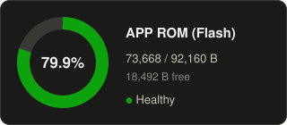
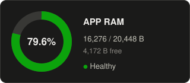
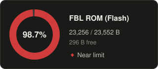
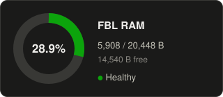
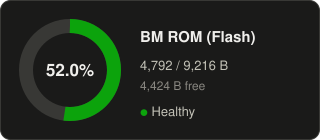
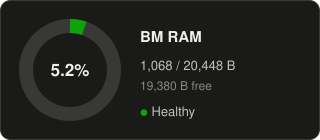

# STM32_RF_HUB

[:page_with_curl:](https://marks100org.github.io/STM32_test_bed/) 

## Memory usage

High-level ROM/RAM usage per image, written by the memory stats step of each build (memory_analyser_stm32). ROM is flash; all images share the same 20 KB of RAM.

<!-- MEMORY:APP:START -->
### APP

_Built 2026-10-29 from `APP.map`_

| Region | Used | Free | Used % |
|---|---:|---:|---:|
| ROM (Flash) | 77,448 B | 14,712 B | 84.0% |
| RAM | 19,080 B | 1,368 B | 93.3% |

  
  

<!-- MEMORY:APP:END -->

<!-- MEMORY:FBL:START -->
### FBL

_Built 2026-10-29 from `FBL.map`_

| Region | Used | Free | Used % |
|---|---:|---:|---:|
| ROM (Flash) | 23,256 B | 296 B | 98.7% |
| RAM | 5,908 B | 14,540 B | 28.9% |

  
  

<!-- MEMORY:FBL:END -->

<!-- MEMORY:BM:START -->
### BM

_Built 2026-10-28 from `BM.map`_

| Region | Used | Free | Used % |
|---|---:|---:|---:|
| ROM (Flash) | 4,792 B | 4,424 B | 52.0% |
| RAM | 1,068 B | 19,380 B | 5.2% |

  
  

<!-- MEMORY:BM:END -->
