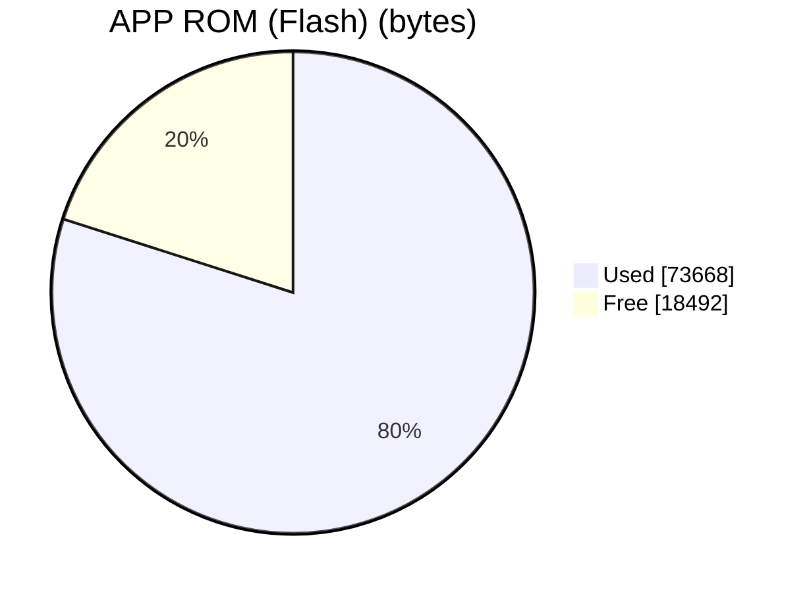
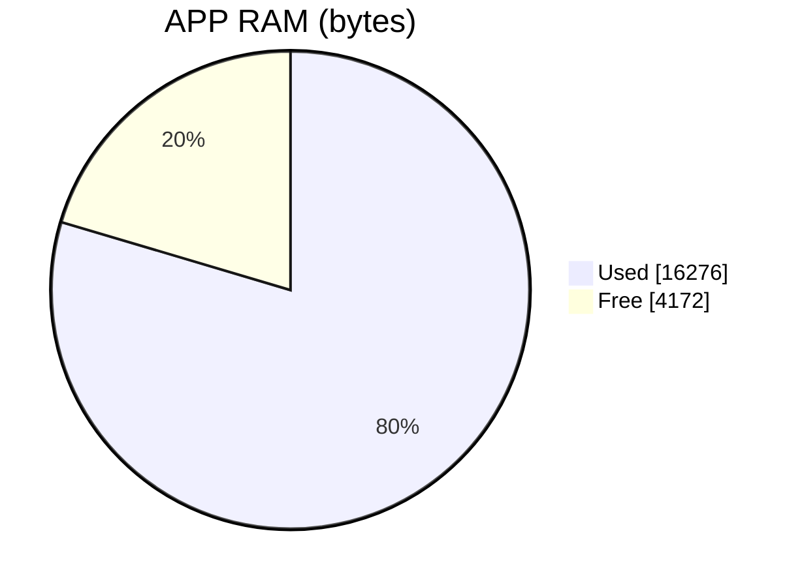
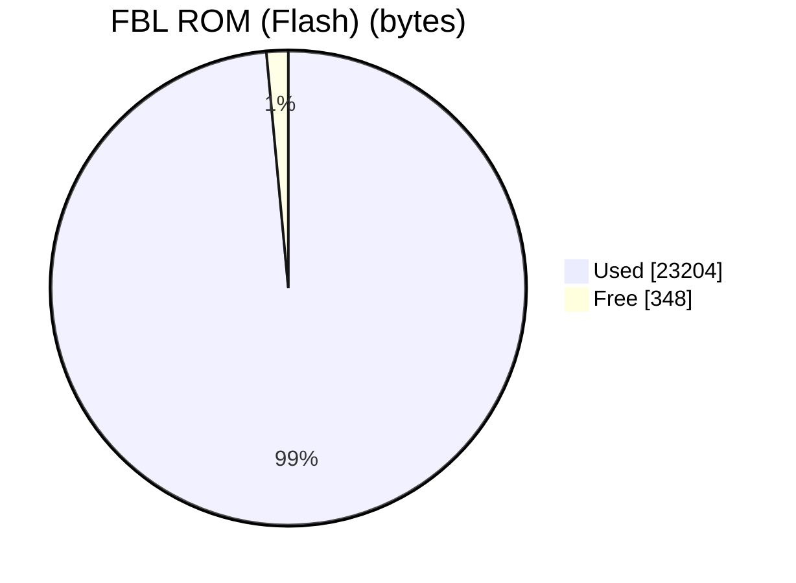
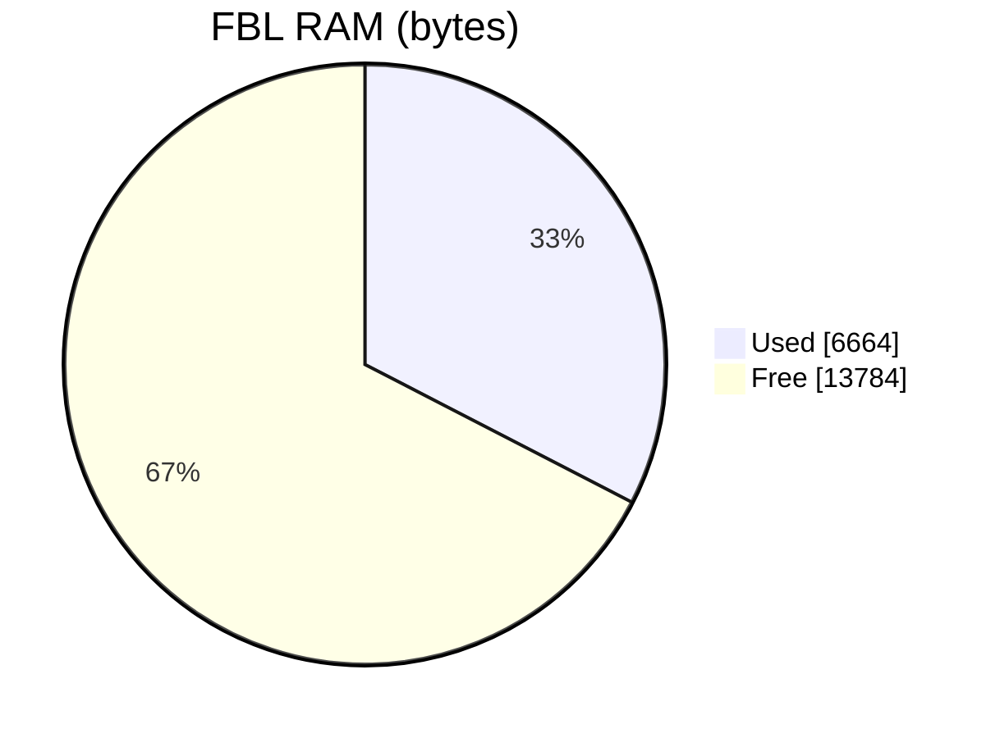
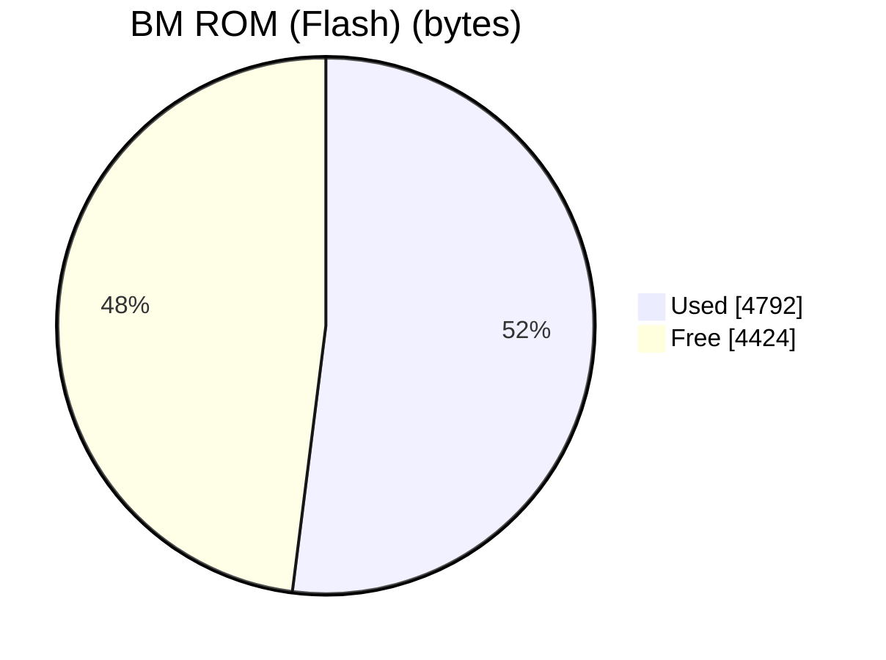
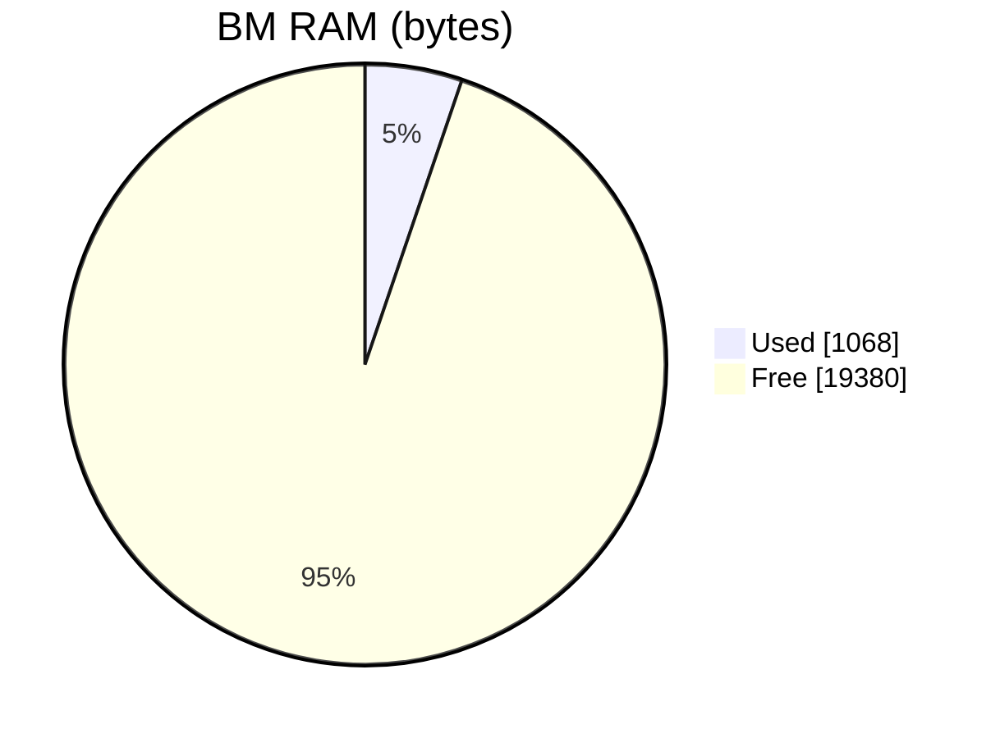

# STM32_RF_HUB

[:page_with_curl:](https://marks100org.github.io/STM32_test_bed/) 

## Memory usage

High-level ROM/RAM usage per image, written by the memory stats step of each build (memory_analyser_stm32). ROM is flash; all images share the same 20 KB of RAM.

<!-- MEMORY:APP:START -->
### APP

_Built 2026-10-18 from `APP.map`_

| Region | Used | Free | Used % |
|---|---:|---:|---:|
| ROM (Flash) | 73,668 B | 18,492 B | 79.9% |
| RAM | 16,276 B | 4,172 B | 79.6% |

<!-- MEMORY:APP:END -->

<!-- MEMORY:FBL:START -->
### FBL

_Built 2026-10-18 from `FBL.map`_

| Region | Used | Free | Used % |
|---|---:|---:|---:|
| ROM (Flash) | 23,204 B | 348 B | 98.5% |
| RAM | 6,664 B | 13,784 B | 32.6% |

<!-- MEMORY:FBL:END -->

<!-- MEMORY:BM:START -->
### BM

_Built 2026-10-16 from `BM.map`_

| Region | Used | Free | Used % |
|---|---:|---:|---:|
| ROM (Flash) | 4,792 B | 4,424 B | 52.0% |
| RAM | 1,068 B | 19,380 B | 5.2% |

<!-- MEMORY:BM:END -->
