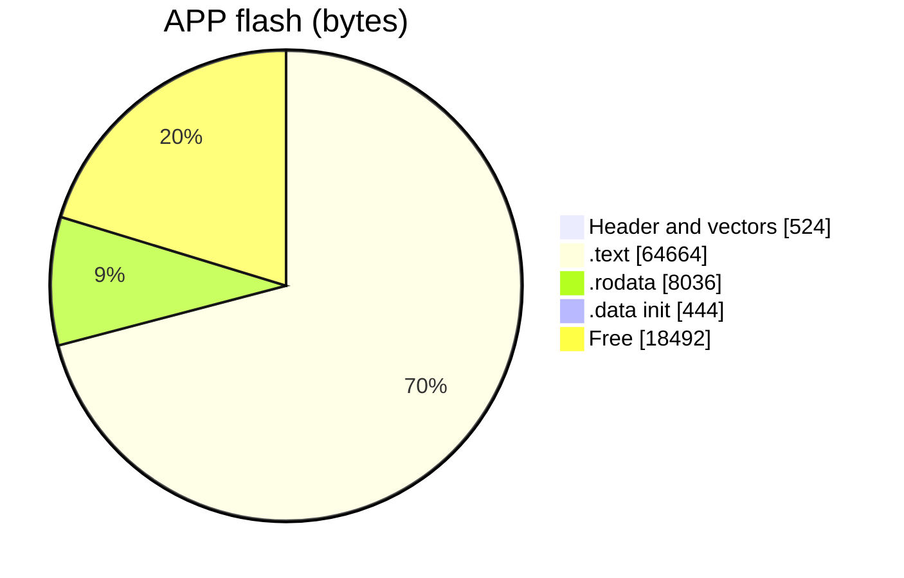
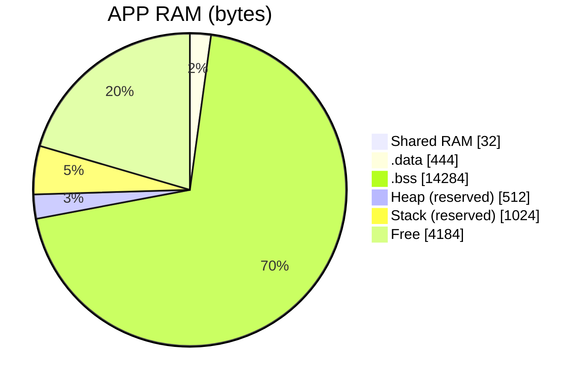
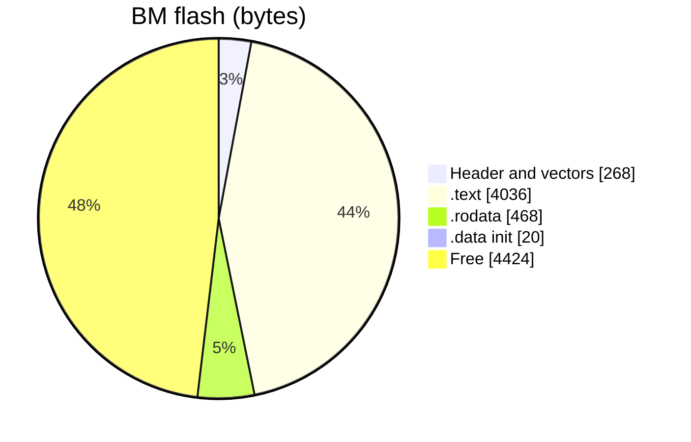
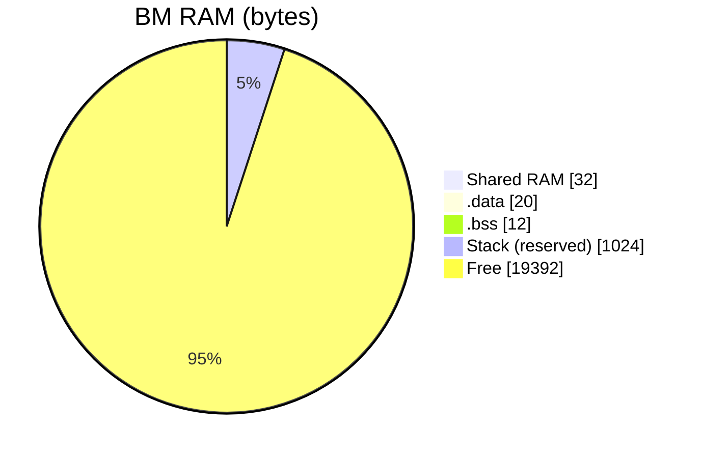
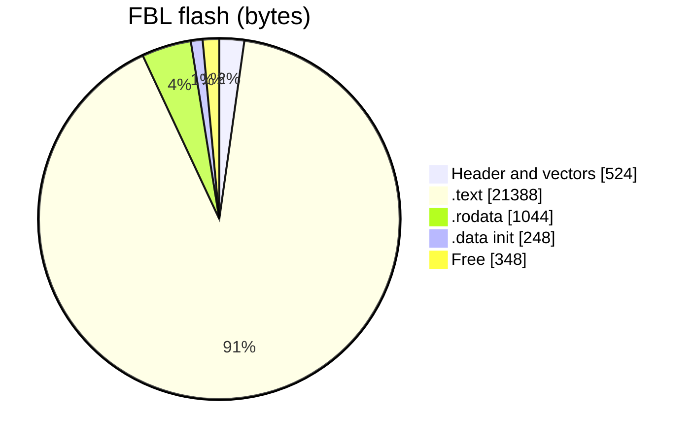
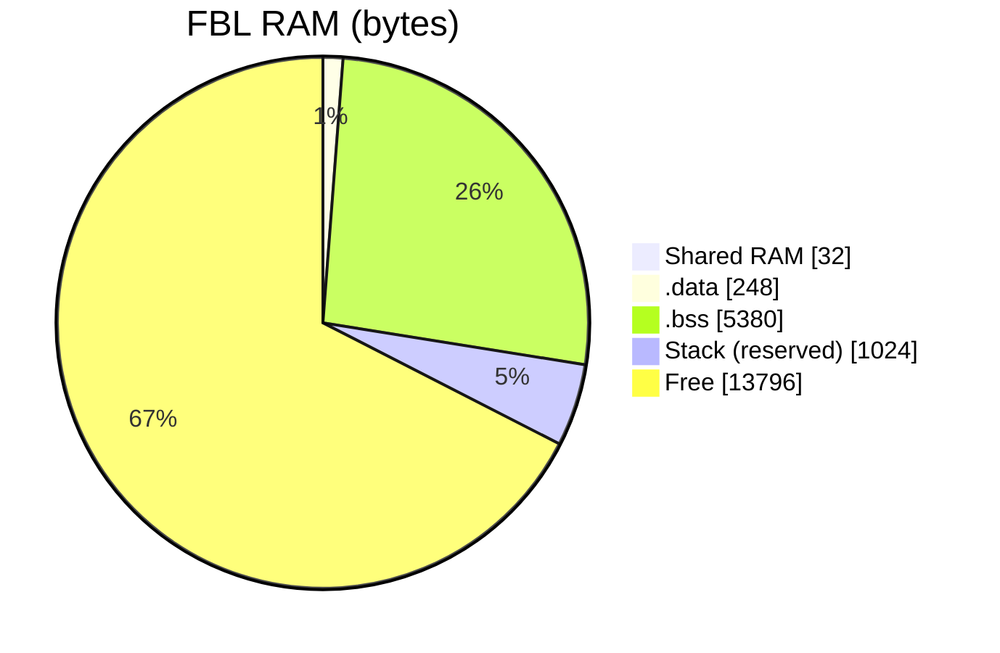

# STM32_RF_HUB

[:page_with_curl:](https://marks100org.github.io/STM32_test_bed/) 

<!-- MEMORY_REPORT:START -->
## Memory usage

Generated from the linker `.map` files by `Tool_cfg/MAP_REPORT/map_report.py`. All images use the same 20 KB of RAM; heap and stack are the linker reservations.

| Project | Flash used | Flash % | RAM used | RAM % | Map built |
|---|---|---|---|---|---|
| APP | 73,668 / 92,160 B | 79.9% | 16,296 / 20,480 B | 79.6% | 2026-10-18 |
| BM | 4,792 / 9,216 B | 52.0% | 1,088 / 20,480 B | 5.3% | 2026-10-16 |
| FBL | 23,204 / 23,552 B | 98.5% | 6,684 / 20,480 B | 32.6% | 2026-10-18 |

APP breakdown

BM breakdown

FBL breakdown

<!-- MEMORY_REPORT:END -->
