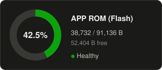
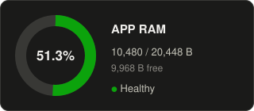
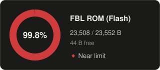
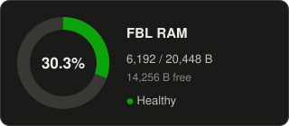
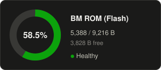
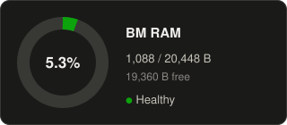

# STM32_RF_HUB

[:page_with_curl:](https://marks100org.github.io/STM32_test_bed/) 

## Memory usage

High-level ROM/RAM usage per image, written by the memory stats step of each build (memory_analyser_stm32). ROM is flash; all images share the same 20 KB of RAM.

<!-- MEMORY:APP:START -->
### APP

_Built 2026-11-07 from `APP.map`_

| Region | Used | Free | Used % |
|---|---:|---:|---:|
| ROM (Flash) | 38,352 B | 53,808 B | 41.6% |
| RAM | 10,480 B | 9,968 B | 51.3% |

  
  

<!-- MEMORY:APP:END -->

<!-- MEMORY:FBL:START -->
### FBL

_Built 2026-11-07 from `FBL.map`_

| Region | Used | Free | Used % |
|---|---:|---:|---:|
| ROM (Flash) | 23,508 B | 1,068 B | 95.7% |
| RAM | 5,928 B | 14,520 B | 29.0% |

  
  

<!-- MEMORY:FBL:END -->

<!-- MEMORY:BM:START -->
### BM

_Built 2026-11-07 from `BM.map`_

| Region | Used | Free | Used % |
|---|---:|---:|---:|
| ROM (Flash) | 5,388 B | 2,804 B | 65.8% |
| RAM | 1,088 B | 19,360 B | 5.3% |

  
  

<!-- MEMORY:BM:END -->
